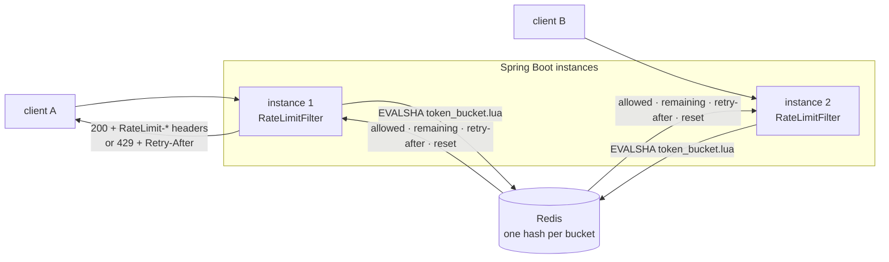

# redis-rate-limiter

[](https://github.com/geethapriya1625/redis-rate-limiter/actions/workflows/ci.yml)


**Distributed token-bucket rate limiting for Spring Boot. One Redis round trip per request, exact under concurrency, consistent across any number of app instances.**



## Why a Lua script

A rate limiter that reads the bucket, does the math in Java, and writes it back has a race. Two instances can read "1 token left" at the same moment and both let a request through. Under load that isn't an edge case. Here is the same race run both ways against a real Redis, from [`docs/bench-results.txt`](docs/bench-results.txt):

| 32 threads × 20 calls on one bucket with capacity 50 | allowed |
|---|---|
| Client-side `GET` → compute → `SET` | **635–640** (lost updates; the limit barely holds) |
| `token_bucket.lua` (this project) | **exactly 50**, every run |

The script runs the whole read-refill-take-write cycle atomically inside Redis, using **Redis's own clock** (`TIME`), so app servers with skewed clocks still agree on every bucket.

## Measured performance

From `loadtest/script_bench.py`, 3 runs, on a 2-vCPU cloud VM with Redis 7.0 and the Python benchmark clients **sharing the same 2 cores**:

| | |
|---|---|
| Throughput | **13,075 to 13,573 decisions/s** across 1,000 buckets |
| Round trip p50 / p99 | **123 to 129 µs / 306 to 329 µs** |

These numbers are client-bound: the clients and Redis compete for 2 vCPUs. They're a floor, not a ceiling, and they leave a lot of headroom for an API that handles a few thousand requests per second. Rerun them on your own hardware with `python loadtest/script_bench.py`. CI runs a short version on every push.

## Behaviour

- **Token bucket per (policy, client).** `capacity` sets the burst size and `refill-per-second` the sustained rate (fractional rates are fine). Requests can have a `cost` above 1 for expensive endpoints.
- **Policies by path.** The first matching Spring `PathPattern` wins, so a strict `/api/search/**` policy can sit in front of a looser `/api/**`.
- **Client identity.** The `X-Api-Key` header (configurable) is used when present, otherwise the socket address. `X-Forwarded-For` is deliberately ignored, because anyone can set it. Behind a proxy, configure forwarded-header handling so the remote address is already the real client.
- **Standard headers.** `RateLimit-Limit`, `RateLimit-Remaining` and `RateLimit-Reset` follow the IETF `draft-ietf-httpapi-ratelimit-headers`. A `429` includes `Retry-After` and a `problem+json` body.
- **Explicit failure mode.** If Redis is unreachable, `fail-open: true` lets traffic through unmetered and counts `ratelimit.errors`, while `fail-open: false` returns `503`. Short Redis timeouts (250 ms) keep a sick limiter from turning into a slow API. Both modes are tested.
- **Self-cleaning.** Each bucket gets a `PEXPIRE` set to just past the time it would be full again, so idle clients cost no memory.
- **Metrics.** `ratelimit.decisions{policy,outcome}` and `ratelimit.errors{policy}` via Micrometer.

```yaml
ratelimit:
  fail-open: true
  client-header: X-Api-Key
  policies:
    - name: search            # first match wins
      path-pattern: /api/search/**
      capacity: 5
      refill-per-second: 1
    - name: default
      path-pattern: /api/**
      capacity: 20
      refill-per-second: 10
```

## Run it

```bash
docker compose up --build      # Redis + two app instances on :8081 and :8082
for i in $(seq 1 7); do
  curl -s -o /dev/null -w "%{http_code} " -H 'X-Api-Key: demo' localhost:808$(( i % 2 + 1 ))/api/search
done
# expected: 200 200 200 200 200 429 429  (requests alternate between instances; the limit is shared)
```

`loadtest/k6-two-instances.js` drives 100 req/s at both instances with one API key, to show the limit holding at the HTTP level.

## Tests

```bash
mvn verify                     # Testcontainers starts Redis 7
TEST_REDIS_PORT=6379 mvn verify  # or use a local Redis
```

| Suite | Covers |
|---|---|
| `RedisTokenBucketRateLimiterTest` | burst then deny, refill timing, multi-token cost, oversized requests, independent buckets, TTL, and 32 threads racing one bucket → exactly `capacity` allowed |
| `RateLimitFilterTest` | headers counting down, `429` + `Retry-After` + `problem+json`, per-client buckets, first-match policy, unmatched paths untouched |
| `FailOpenTest` / `FailClosedTest` | Redis on a dead port: traffic flows unmetered, or `503`, as configured |
| `loadtest/script_bench.py` (CI job) | the Lua script on its own: correctness, the 640-call race, and throughput |

## Design notes

- **Token bucket over fixed windows.** Fixed windows allow 2× the limit across a window boundary. Sliding logs are exact but store every timestamp. A token bucket costs two fields per client and gives a smooth rate plus an explicit burst size.
- **Floating-point tokens.** Partial refills accumulate correctly at low rates (e.g. 1 request per 10 s) instead of rounding down to zero forever.
- **Script caching.** Spring Data Redis sends `EVALSHA` and falls back to `EVAL` if Redis restarted and lost the script, so nothing needs to be preloaded.
- **Not included, deliberately:** Redis Cluster hash tags (keys are single-bucket, so they already shard cleanly), and per-tenant dynamic policies. Both are natural next steps.

## License

MIT
